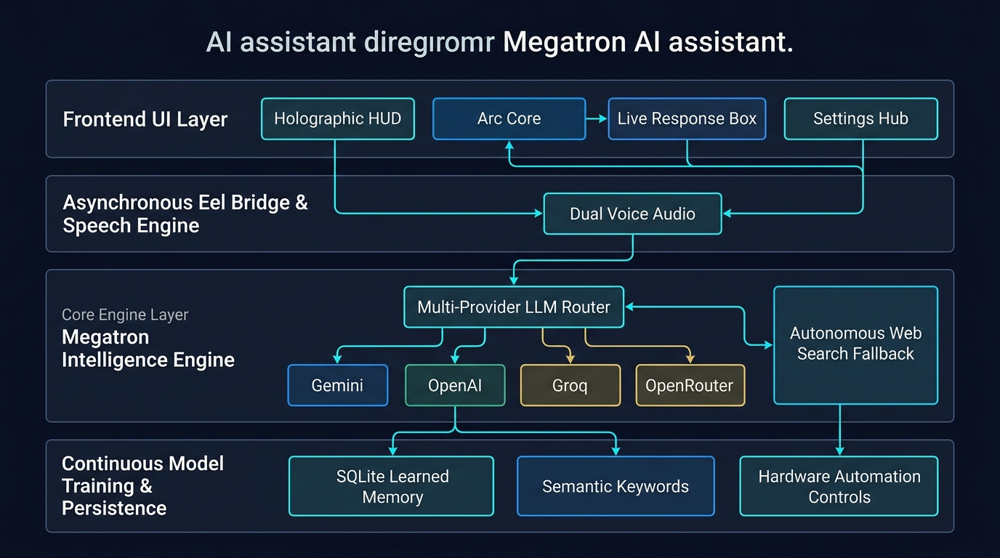
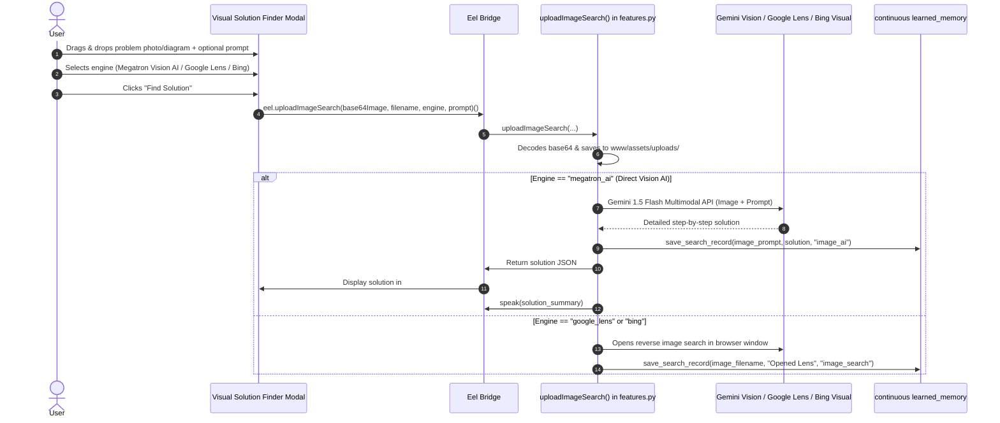
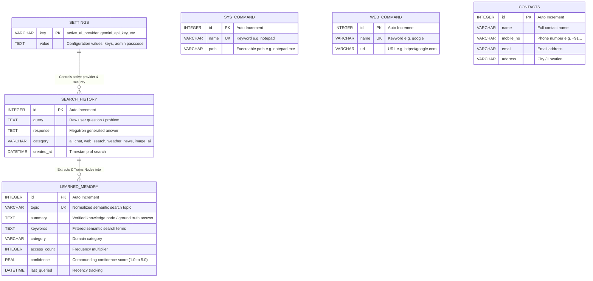

# 🏛️ Megatron AI — Architecture & System Diagrams

This document contains visual architectural specifications, component maps, and sequence diagrams detailing how Megatron AI is engineered, how data moves through its subsystems, and how continuous training compounds over time.

---

## 🖼️ Full System Architecture Visual Map

---

## 1. System Overview Architecture

```mermaid
flowchart TB
    subgraph ClientLayer ["1. CLIENT PRESENTATION LAYER (HTML5 / Vanilla CSS3 / JS)"]
        UI_HUD["Holographic Telemetry HUD\n(Status, Trained Nodes, Net)"]
        UI_Arc["Arc Reactor Core Hub\n(Canvas Particle Equalizer)"]
        UI_Response["Holographic Live Response Card\n(Text, Replay Voice, Copy)"]
        UI_Inputs["Input Toolbar & Quick Dock\n(Chatbox, Mic, Quick AI, Tools)"]
        UI_Modals["Settings & Intelligence Hub\n(Multi-Provider Switcher, Vault, Apps)"]
        UI_VisionModal["Visual Solution Finder Modal\n(Drag & Drop, Camera)"]
    end

    subgraph BridgeLayer ["2. ASYNCHRONOUS DUAL-BRIDGE LAYER"]
        EelBridge["Eel WebSocket RPC Bridge\n(Two-way Python <-> JS Dispatch)"]
        WebSpeech["Web Speech Synthesis API\n(Browser-Side Crisp Voice Audio)"]
    end

    subgraph EngineLayer ["3. MEGATRON CORE INTELLIGENCE ENGINE (Python)"]
        CMD["engine/command.py\n• allCommands() Router\n• Voice & Text Intake\n• System SAPI5 pyttsx3 (pythoncom)"]
        FEAT["engine/features.py\n• geminai() Conversational Brain\n• call_llm_api() Multi-Provider Router\n• handle_autonomous_query() Live Engine\n• uploadImageSearch() Vision Solver"]
        CONF["engine/config.py\n• App Modes & Environment Config"]
        HELP["engine/helper.py\n• Markdown Sanitizer & ADB Bridge"]
    end

    subgraph ProviderLayer ["4. MULTI-PROVIDER AI & ONLINE SEARCH FEEDS"]
        LLM_Gemini["Google Gemini\n(1.5 Flash / 2.0 Flash)"]
        LLM_OpenAI["OpenAI\n(GPT-4o Mini)"]
        LLM_Groq["Groq Cloud\n(Llama 3.3 70B Fast)"]
        LLM_OpenRouter["OpenRouter\n(DeepSeek / Claude)"]
        LLM_Custom["Custom / Local LLM\n(Ollama / vLLM / LM Studio)"]
        AUTONOMOUS["Autonomous Live Web Feeds\n• DuckDuckGo Search\n• wttr.in Live Weather\n• Live RSS News & Headliners\n• YouTube Direct Stream"]
    end

    subgraph DataLayer ["5. PERSISTENCE & CONTINUOUS MODEL TRAINING (SQLite)"]
        DB_Search["search_history Table\n(Raw Queries, Responses, Timestamps)"]
        DB_Memory["learned_memory Table\n(Topics, Summaries, Keywords, Confidence, Counts)"]
        DB_Settings["settings Table\n(Active Provider, API Keys, Quota Flags, Passcode)"]
        DB_SysCmd["sys_command & web_command\n(Custom Shell & URL Shortcuts)"]
        DB_Contacts["contacts & info Table\n(Comms Phonebook & Profile)"]
    end

    subgraph HardwareLayer ["6. HARDWARE & OPERATING SYSTEM LAYER"]
        HW_Windows["Windows OS Controls\n(pyautogui: Volume, Lock, Desktop, App Launch)"]
        HW_Android["Android Mobile Bridge\n(ADB: Calls, SMS, Torch, Battery)"]
        HW_Audio["Hardware Microphone & Speakers\n(speech_recognition / SAPI5)"]
    end

    %% Connections
    UI_Inputs -->|User Query| EelBridge
    UI_Modals -->|Save Keys / Train| EelBridge
    UI_VisionModal -->|Base64 Image| EelBridge
    EelBridge <--> CMD
    EelBridge <--> FEAT
    CMD --> FEAT
    FEAT -->|Semantic Neural Recall| DataLayer
    FEAT -->|1. Try Active Provider| ProviderLayer
    FEAT -->|2. Quota Ended? Failover| ProviderLayer
    FEAT -->|3. Fallback to Live Feeds| AUTONOMOUS
    FEAT -->|Continuous Training Save| DB_Search
    FEAT -->|Topic & Keyword Indexing| DB_Memory
    CMD -->|OS Commands| HW_Windows
    CMD -->|Mobile Commands| HW_Android
    CMD -->|SAPI5 Voice| HW_Audio
    FEAT -->|Render Live Text| UI_Response
    FEAT -->|Render Voice in Tab| WebSpeech
```

---

## 2. Sequence Diagram: Query Execution & Continuous Training Flow

```mermaid
sequenceDiagram
    autonumber
    actor User as Operator / User
    participant Browser as Megatron Web UI (Browser)
    participant Bridge as Eel WebSocket Bridge
    participant Cmd as engine/command.py
    participant Feat as engine/features.py
    participant DB as engine/db.py (SQLite)
    participant AI as Active AI Provider (Gemini / OpenAI / Groq)
    participant TTS as Dual Voice Engine (pyttsx3 + Browser)

    User->>Browser: Types query or clicks Voice Mic
    Browser->>Bridge: eel.allCommands(message)()
    Bridge->>Cmd: allCommands(query)
    Cmd->>Feat: geminai(raw_query)

    rect rgb(10, 25, 45)
        Note over Feat,DB: PHASE 1: Semantic Neural Ground Truth Recall
        Feat->>DB: find_learned_context(raw_query)
        DB-->>Feat: Return verified prior knowledge & facts (if matched)
    end

    rect rgb(15, 30, 60)
        Note over Feat,AI: PHASE 2: Multi-Provider LLM Call with Quota Resilience
        Feat->>AI: call_llm_api(prompt + memory_context)
        alt Active Provider Quota OK (200)
            AI-->>Feat: Return generated response
        else Quota Ended (429 / Insufficient Quota)
            AI-->>Feat: 429 Error
            Feat->>DB: mark_provider_quota_exhausted(provider, True)
            Feat->>AI: Failover to backup attached provider OR Autonomous Web Search
            AI-->>Feat: Return failover intelligence
        end
    end

    rect rgb(20, 40, 75)
        Note over Feat,DB: PHASE 3: Continuous Model Training on Query & Response
        Feat->>DB: save_search_record(query, response, category)
        Note over DB: 1. Append to search_history<br/>2. Extract keywords & stopwords<br/>3. Upsert into learned_memory<br/>4. Increment access_count & confidence
    end

    rect rgb(25, 50, 90)
        Note over Feat,Browser: PHASE 4: Dual Visual & Voice Presentation
        Feat->>Cmd: speak(response_text)
        Cmd->>TTS: SAPI5 pyttsx3.init() in background thread
        Cmd->>Bridge: eel.showLiveResponse(text) & receiverText(text)
        Bridge->>Browser: Render text in Holographic Live Response Box
        Bridge->>Browser: Play Web Speech API voice audio
        Bridge->>Browser: Update HUD Trained Nodes Badge (+1)
    end

    Browser-->>User: Displays readable answer on screen + Speaks out loud
```

---

## 3. Sequence Diagram: Multi-Provider Quota Failover Mechanism

```mermaid
sequenceDiagram
    autonumber
    participant Engine as Megatron Brain (features.py)
    participant Provider1 as Provider 1 (e.g. Gemini Free Tier)
    participant DB as SQLite Settings & Quota Table
    participant Provider2 as Provider 2 (e.g. Groq Cloud / OpenAI)
    participant AutoSearch as Autonomous Live Web Engine

    Engine->>Provider1: POST query payload
    Provider1-->>Engine: HTTP 429 Too Many Requests (Quota Exhausted)
    
    rect rgb(40, 15, 25)
        Note over Engine,DB: Quota Exhaustion Detected
        Engine->>DB: mark_provider_quota_exhausted('gemini', True)
        Note over DB: Sets quota warning badge in browser settings
    end

    rect rgb(20, 35, 60)
        Note over Engine,Provider2: Automatic Failover Activated
        Engine->>Provider2: POST query to backup attached provider
        alt Backup Provider Succeeds
            Provider2-->>Engine: HTTP 200 OK (intelligence response)
        else Backup Provider Missing / Also Exhausted
            Engine->>AutoSearch: Fallback to Megatron Autonomous Live Search
            AutoSearch-->>Engine: Live DuckDuckGo / Wikipedia / Weather / News answer
        end
    end

    Engine-->>Engine: Append quota notice & present verified response to user
```

---

## 4. Visual Solution Finder Sequence Diagram

---

## 5. Database Schema & Entity Relationship Model

---

## 6. Hybrid Deployment & Permission Architecture

| Feature | Browser Web Agent (`localhost:8000`) | Windows Desktop Software (`run_megatron_windows.bat`) | Android Mobile App (`android_app/`) |
| :--- | :---: | :---: | :---: |
| **Launch Command** | Double-click or browser URL | `run_megatron_windows.bat` | Tap Megatron Android APK Icon |
| **Biometric Face Scan** | **Bypassed Automatically** (Frictionless) | Optional On-Demand | Not Required |
| **Master PC Volume Control** | Restricted (Safe Agent) | **Full Hardware Control** | Mobile Volume Keys |
| **Lock Workstation / Screenshot**| Restricted | **Full OS Access** (pyautogui/rundll32) | Camera Capture |
| **WhatsApp Automation** | Restricted | **Full Desktop Automation** | Native Android SMS/Intent |
| **Multi-Provider AI Switcher** | **Yes** (Browser GUI) | **Yes** | **Yes** |
| **Continuous Model Training** | **Yes** (Real-time DB) | **Yes** (Shared DB) | **Yes** (Shared API/Sync) |
| **Global Wake Key** | Win+J (when window active) | **Win+J Global System Hotkey** | On-screen Mic / Widget |
| **Clean Complete Uninstaller** | `uninstall_megatron.bat` | `windows_app/uninstall.bat` | Android OS Settings -> Uninstall |
