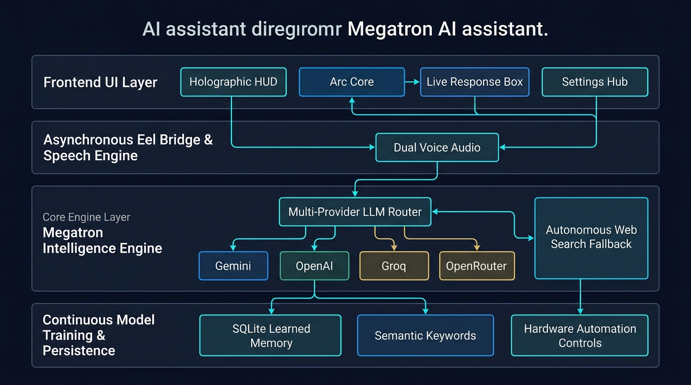

# 🛡️ MEGATRON AI — Architecture & Knowledge System

Welcome to the **Megatron AI System Documentation and Architecture Knowledge Base**. This repository directory serves as your permanent architectural blueprint, developer handbook, and technical interview preparation guide.

---

## 📚 Document Index

| Document | Purpose | Key Audience |
| :--- | :--- | :--- |
| **[ARCHITECTURE_DIAGRAMS.md](ARCHITECTURE_DIAGRAMS.md)** | Visual Mermaid diagrams of system components, sequence flows, multi-provider failover, and continuous training. | Architects, Reviewers, You |
| **[FOLDER_AND_FILE_GUIDE.md](FOLDER_AND_FILE_GUIDE.md)** | Complete folder-by-folder & file-by-file breakdown with line-level guides on how to expand features in the future. | Developers, Maintainers |
| **[INTERVIEW_PREPARATION_GUIDE.md](INTERVIEW_PREPARATION_GUIDE.md)** | High-level architectural defense, design tradeoffs, 60-second elevator pitch, and technical Q&A for senior AI engineer interviews. | Technical Interviewers |

---

## 🖼️ Megatron System Architecture Overview



---

## ⚡ Quick Architecture Summary

```
+---------------------------------------------------------------------------------------+
|                                    MEGATRON FRONTEND                                   |
|   Holographic HUD  |  Arc Core Hub  |  Live Response Card  |  Settings & Training Hub  |
+---------------------------------------------------------------------------------------+
                                           ↕  (Eel WebSocket Bridge)
+---------------------------------------------------------------------------------------+
|                                MEGATRON PYTHON ENGINE                                 |
|  [command.py] Voice / Text Intake & Dual Audio TTS (pyttsx3 COM + Web Speech)         |
|  [features.py] Multi-Provider AI (Gemini / OpenAI / Groq / OpenRouter / Custom)       |
|                Autonomous Live Web Search Fallback (Weather, News, DuckDuckGo)        |
|  [db.py]       Continuous Model Training (TF-IDF Keywords, Confidence, Neural Recall)  |
+---------------------------------------------------------------------------------------+
                                           ↕
+---------------------------------------------------------------------------------------+
|                                PERSISTENCE & HARDWARE                                  |
|  SQLite (megatron.db) | Windows API (pyautogui) | Android Bridge (ADB) | Camera / Vision |
+---------------------------------------------------------------------------------------+
```

---

## 🚀 Key Technical Highlights to Remember

1. **Multi-Provider API Router with Quota Failover**: Seamlessly cycles between Google Gemini, OpenAI, Groq Cloud, OpenRouter, and local Ollama endpoints. Automatically detects HTTP 429 quota exhaustion and failovers to backup providers or autonomous live web search without crashing.
2. **Continuous Dynamic Model Training**: Megatron trains on **every single query and response**. It extracts semantic keywords, indexes topics, compounds confidence scores, and performs neural ground truth recall prior to generating any new answer.
3. **Adaptive Hybrid Deployment**:
   - **Browser Web Agent**: Frictionless, zero-prompt research mode with safe permissions.
   - **Windows Desktop Software**: Full OS hardware automation (master volume, screenshots, desktop lock, WhatsApp automation, Win+J hotkey).
   - **Android Mobile Suite**: Mobile phone calls, SMS, flashlight, and camera visual problem solving.
4. **Complete Clean Uninstallation**: Integrated 1-click self-purging uninstaller (`uninstall_megatron.bat`) that terminates processes, wipes shortcuts, deletes databases, and purges all files from the disk leaving zero residual clutter.
5. **Multi-Device Local Network Server (0.0.0.0 Bind)**: Megatron binds to `0.0.0.0:8000`, broadcasting across the entire local Wi-Fi / Ethernet subnet. Any phone, tablet, or laptop on the network can immediately open `http://<LAN_IP>:8000/index.html` to interact with Megatron and download native software and APKs.
